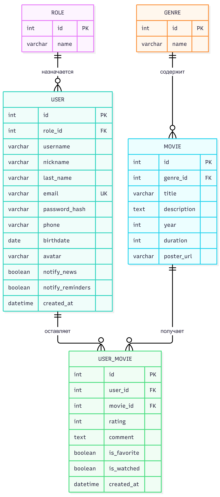

# 🎬 CineNight

**Каталог фильмов для идеальных киновечеров**


**CineNight** — это полноценное веб-приложение на фреймворке Yii2, созданное для организации киновечеров. Проект выполнен в стильной темной кинематографичной теме.

## 📑 Содержание
- [Технологический стек](#технологический-стек)
- [Развертывание проекта](#развертывание-проекта)
- [Структура базы данных](#структура-базы-данных)
- [Функционал](#основной-функционал)
- [Безопасность](#безопасность)
- [Скриншоты](#скриншоты-проекта)

---

## 🛠 Технологический стек
* **Backend:** PHP 8.x, Yii2 Framework
* **База данных:** MySQL
* **Frontend:** HTML5, CSS3 (Flexbox/Grid), Vanilla JavaScript
* **Иконки:** FontAwesome

---

## 🚀 Развертывание проекта

### Шаг 1. Клонирование репозитория
```bash
git clone https://github.com/ваш_логин/ваш_репозиторий.git
cd ваш_репозиторий
```

### Шаг 2. Установка зависимостей
```bash
composer install
```

### Шаг 3. Настройка базы данных
Откройте файл `config/db.php` и укажите ваши данные:
```php
return [
    'class' => 'yii\db\Connection',
    'dsn' => 'mysql:host=localhost;dbname=имя_вашей_бд',
    'username' => 'root',
    'password' => '',
    'charset' => 'utf8',
];
```

### Шаг 4. Применение миграций
```bash
php yii migrate
```

### Шаг 5. Создание папки для аватарок
Создайте папку `web/uploads/avatars/` и дайте ей права на запись.

---

## 🗄️ Структура базы данных

1. **`user`** — пользователи
2. **`role`** — роли
3. **`movie`** — каталог фильмов
4. **`genre`** — жанры
5. **`user_movie`** — оценки, отзывы, избранное

---

## ⚙️ Основной функционал

### 🔐 Аутентификация и роли
* Регистрация, вход, выход.
* Роли: Гость, Пользователь, Администратор.
* Разграничение доступа через `AccessControl`.

### 🎥 Каталог и Поиск
* Пагинация, поиск, фильтры, сортировка.
* Кнопка «Мне повезет».

### 👤 Личный кабинет
* **Профиль:** Загрузка аватарки.
* **Мои голоса:** Оценки и отзывы.
* **Избранное и Просмотренные:** AJAX-списки.
* **Настройки:** Смена пароля.

### 🛡 Админ-панель
* CRUD для Жанров, Фильмов и Пользователей (через **Gii**).
* Просмотр всех отзывов.

---

## 🔒 Безопасность
* Валидация данных (Yii2 Validators).
* Защита от XSS (`Html::encode()`).
* Защита от CSRF (`ActiveForm`).

---

## 📸 Скриншоты проекта

<div align="center">
  <h3>1. Главная страница</h3>
  
  
  <h3>2. Каталог фильмов</h3>
  
  
  <h3>3. Личный кабинет</h3>
  
  
  <h3>4. Админ-панель</h3>
  

  <h3>5. ER-диаграмма</h3>
  
</div>

---

<div align="center">
  <b>Автор:</b> Владимир Великий<br>
  <b>Группа:</b> 53-03 <br>
  <b>Учебное заведение:</b> СПб ГБПОУ "Петровский колледж"
</div>