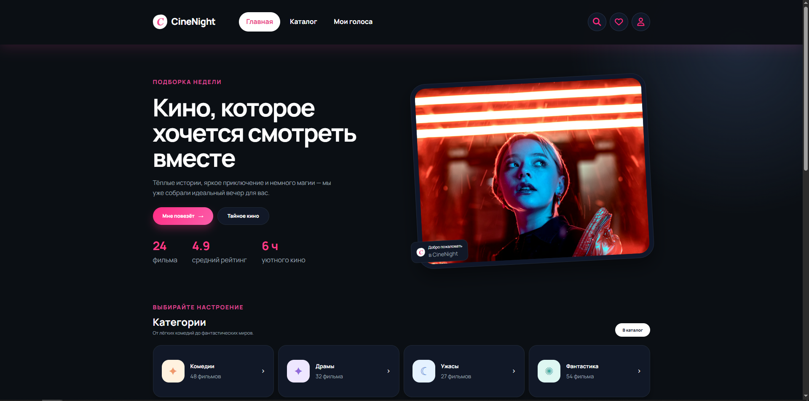
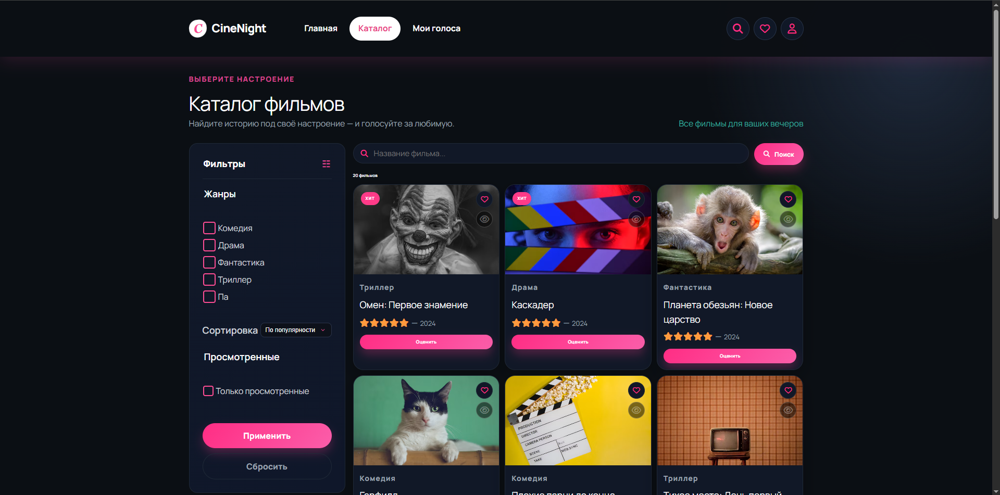
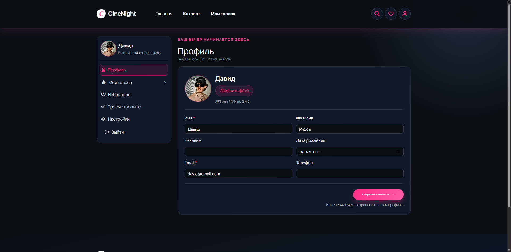
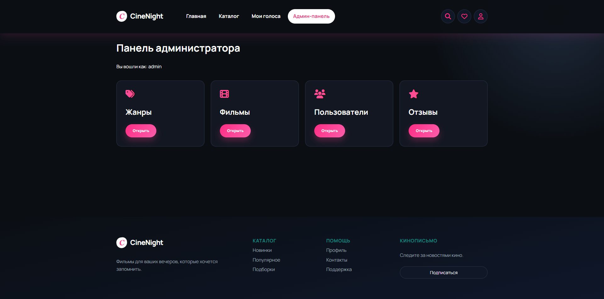

🎬 CineNight
Каталог фильмов для идеальных киновечеров

https://img.shields.io/badge/PHP-8.x-blue?style=for-the-badge&logo=php
https://img.shields.io/badge/Yii2-2.0-purple?style=for-the-badge&logo=yii
https://img.shields.io/badge/MySQL-8.0-orange?style=for-the-badge&logo=mysql
https://img.shields.io/badge/JavaScript-ES6-yellow?style=for-the-badge&logo=javascript

CineNight — это полноценное веб-приложение на фреймворке Yii2, созданное для организации киновечеров. Проект выполнен в стильной темной кинематографичной теме. Пользователи могут искать фильмы, вести списки избранного и просмотренного, загружать аватарки, а также делиться своим мнением, оставляя оценки и отзывы.

📑 Содержание
Технологический стек

Развертывание проекта

Структура базы данных

Функционал

Безопасность

Скриншоты

Автор

🛠 Технологический стек
Backend: PHP 8.x, Yii2 Framework (Basic Template)

База данных: MySQL (через миграции Yii2)

Frontend: HTML5, CSS3 (Flexbox/Grid), Vanilla JavaScript (Fetch API, модальные окна)

Иконки: FontAwesome

🚀 Развертывание проекта
Для запуска проекта на локальном сервере (например, OpenServer) выполните следующие шаги:

Шаг 1. Клонирование репозитория
bash
git clone https://github.com/ваш_логин/ваш_репозиторий.git
cd ваш_репозиторий
Шаг 2. Установка зависимостей
bash
composer install
Шаг 3. Настройка базы данных
Откройте файл config/db.php и укажите ваши данные:

php
return [
    'class' => 'yii\db\Connection',
    'dsn' => 'mysql:host=localhost;dbname=имя_вашей_бд',
    'username' => 'root',
    'password' => '',
    'charset' => 'utf8',
];
Шаг 4. Применение миграций
bash
php yii migrate
Шаг 5. Создание папки для аватарок
Создайте папку web/uploads/avatars/ и дайте ей права на запись.

Шаг 6. Настройка веб-сервера
Настройте Document Root так, чтобы корневая директория указывала на папку web.

🗄️ Структура базы данных
Проект использует 5 связанных таблиц (связи реализованы через внешние ключи FOREIGN KEY и ActiveRecord связи hasOne / hasMany):

user — пользователи (логин, email, хеш пароля, аватарка, настройки).

role — справочник ролей (гость, пользователь, админ).

movie — каталог фильмов (название, описание, постер, год, жанр).

genre — справочник жанров.

user_movie — связующая таблица (оценки, отзывы, избранное, просмотрено).

⚙️ Основной функционал
🔐 Аутентификация и роли
Регистрация, вход, выход из системы.

Безопасное хранение паролей (Bcrypt).

Роли: Гость (просмотр), Пользователь (оценки, списки), Администратор (полный доступ).

Разграничение прав доступа через AccessControl.

🎥 Каталог и Поиск
Вывод фильмов с постраничной пагинацией.

Поиск по названию, фильтрация по жанрам.

Сортировка (по новинкам, по алфавиту, по рейтингу).

Интерактивная кнопка «Мне повезет».

👤 Личный кабинет
Профиль: Редактирование данных, загрузка аватарки (UploadedFile).

Мои голоса: Оценки, отзывы, их редактирование и удаление.

Избранное и Просмотренные: AJAX-добавление в списки.

Настройки: Смена пароля и управление уведомлениями.

🛡 Админ-панель
Защищена от обычных пользователей (403 Forbidden).

CRUD для Жанров, Фильмов и Пользователей (через Gii).

Просмотр всех отзывов.

🔒 Безопасность
Валидация входящих данных (Yii2 Validators).

Защита от XSS (Html::encode()).

Защита от CSRF (ActiveForm).

Безопасная загрузка файлов.

📸 Скриншоты проекта

 <h3>1. Главная страница</h3>  <h3>2. Каталог фильмов</h3>  <h3>3. Личный кабинет</h3>  <h3>4. Админ-панель</h3>  

 <b>Автор:</b> Владимир Великий   <b>Группа:</b> 53-03   <b>Учебное заведение:</b> СПб ГБПОУ "Петровский колледж" 
